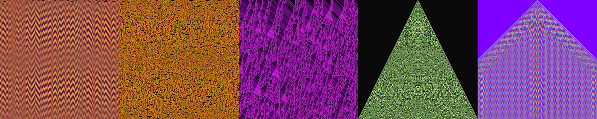

# Complex Cellular Automata Exploration Pipeline

This project is a multi-agent automated pipeline designed to discover, simulate, and visually review novel multi-state cellular automata (CA) rules across many domains, with the goal of discovering new rules that lead to insteresting structural patterns.

The instructions of the orchestrator agent are defined in the `.agentrules` file. You can change the parameters of the pipeline by modifying the `.agentrules` file. The pipeline is divided into 10 loops, each corresponding to a specific domain focus. You can change these domains to other ones or instrucct the LLM to create new ones.



---

## Project Structure


```
├── ca_core/                 # Shared simulation engine + automatic quality gate
│   └── template_generate_ca.py   # Starting point for each loop's generate_ca.py
├── showcase/                # The original PNGs of the 30 showcase picks (committed)
├── hall_of_fame/            # The 30 showcase rules, ported to the engine and reproducible
├── generations/loop_N/      # One folder per loop
│   ├── rules.md             # Rule definitions designed by RuleDesigner subagent
│   ├── generate_ca.py       # The loop's rules, written by CodeGenerator
│   ├── manifest.json        # Seeds and settings of the last run (loops 26+)
│   ├── triage.md / .json    # Automatic quality gate results (loops 26+)
│   ├── review_report.md     # Visual analysis and top winner selection by VisualReviewer
│   └── output/              # 20 space-time diagrams (800x800 PNG files)
│       ├── rule_01_single_seed.png
│       ├── rule_01_random.png
│       └── ...
```

### Additional Root Files
- **`gif_showcase.py`**: Stitches the chosen winning diagrams in `showcase/` into the animated 1x5 showcase GIF.
- **`.agentrules`**: Standard operating procedures defining the multi-agent pipeline and loop domains.

---

## Shared Engine & Quality Gate

From loop 26 onward, a loop's `generate_ca.py` only declares its `RULES` (step function, palette, and optional custom start or hidden channels). The `ca_core` engine does everything else the same way for every loop: initial conditions, seeding, simulation, rendering and file naming. Loops 1-25 are older self-contained scripts.

Run from the repository root:

```bash
python -m ca_core run generations/loop_26               # simulate, render the 20 PNGs, triage them
python -m ca_core run generations/loop_26 --rules 3,7   # re-run only some rules after retuning
python -m ca_core triage generations                    # re-score the images of every loop
```

- **Reproducible**: each image's seed is derived from (loop, rule, init type) and recorded in `manifest.json`, so a re-run produces identical images.
- **Quality gate**: `triage.md` labels every image dead, frozen, periodic, translating, near-static, noise or dynamic, based on its last rows. Rules where every image is dead or frozen before the halfway row are marked REWORK. The CodeGenerator retunes them before the VisualReviewer sees the loop.

---

## Showcase & Hall of Fame

- **`showcase/`** keeps the original images of the 30 showcase picks. Generated PNGs are otherwise not committed, and several picks came from unseeded randomness, so these files are the only copies.
- **`hall_of_fame/`** holds those 30 rules ported to the engine, so they can be re-rendered at any size with fixed seeds: `python -m ca_core run hall_of_fame`. Deterministic rules match the originals exactly. Stochastic ones behave identically to their original code but draw different random numbers. See [`hall_of_fame/README.md`](hall_of_fame/README.md) for each rule.

---


###  Requirements
Ensure you have the required Python packages installed as well as Gemini:
```bash
pip install numpy matplotlib pillow
```

